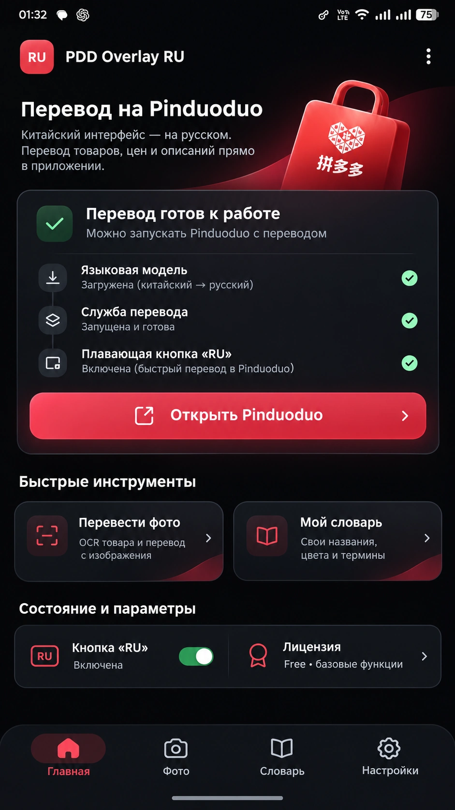
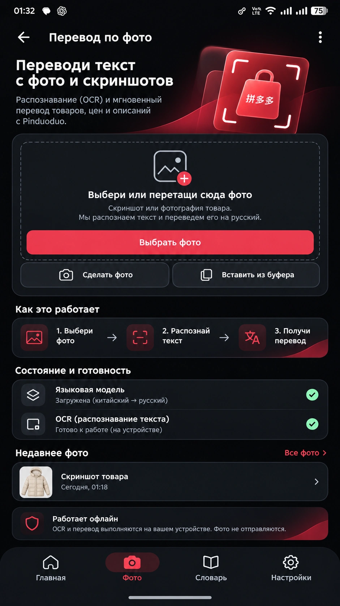
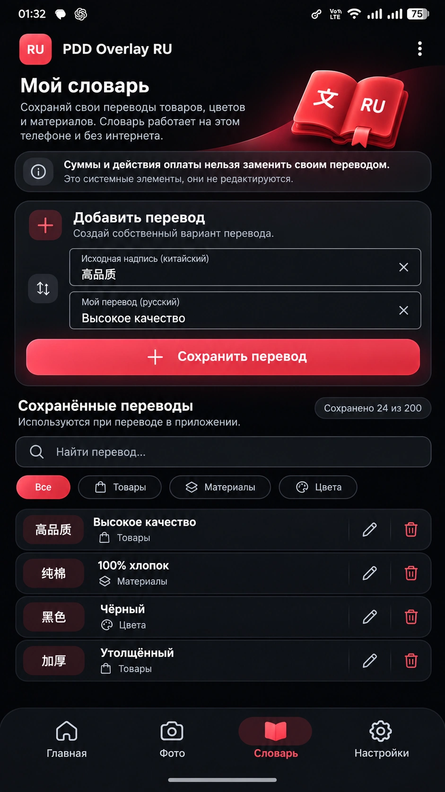
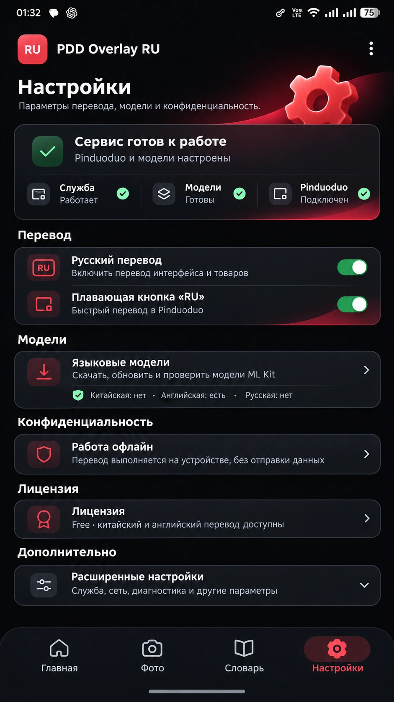
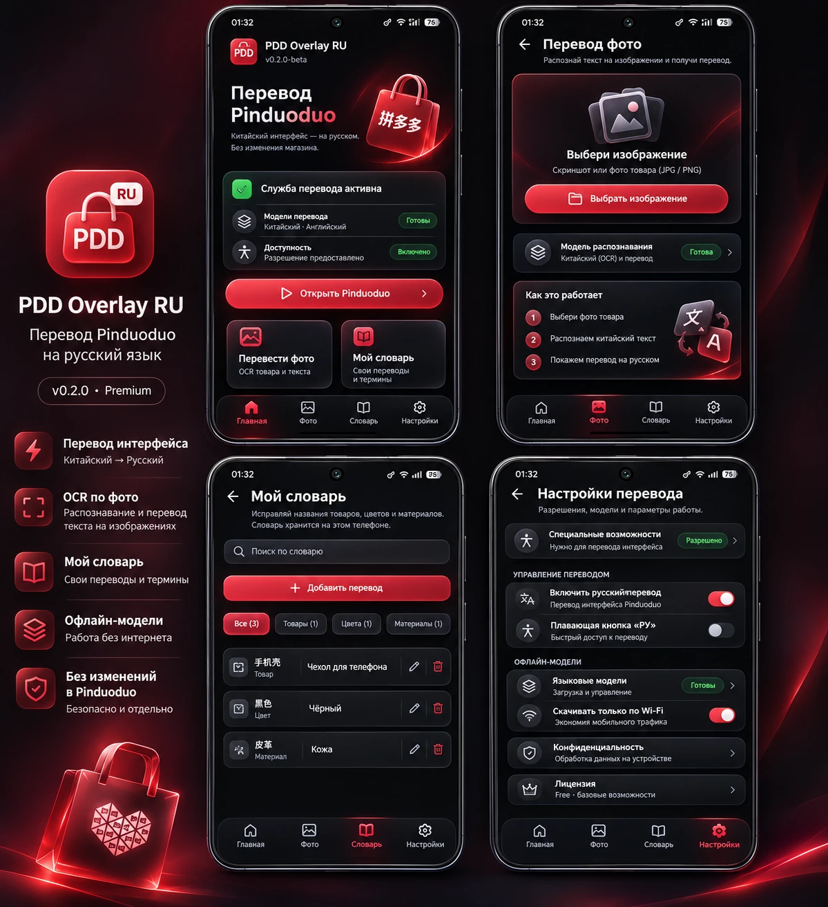

# PDD Premium AMOLED 3D — visual references

**Status:** design references / proposed implementation. These are not screenshots of the installed Android build.

This folder archives four approved Android mockups as high-resolution `WebP` (941×1672), re-encoded at quality 95 from the original PNG images supplied/generated in the design conversation. It also contains one new refinement board. The original PNG bytes are preserved separately in the conversation's downloadable reference archive; avoid treating the re-encoded WebP files as byte-identical PNGs.

## Original screen references

| Главная | Фото / OCR |
|:---:|:---:|
|  |  |
| [Open full mockup](references/home.webp) | [Open full mockup](references/photo-ocr.webp) |

| Мой словарь | Настройки |
|:---:|:---:|
|  |  |
| [Open full mockup](references/glossary.webp) | [Open full mockup](references/settings.webp) |

## Proposed coherent refinement

[Open refined design board](references/premium-concept-board.webp)

## How to use these images

- `references/` contains **visual references**, not application screenshots, APK resources or interaction proofs.
- `DESIGN.md` defines the accepted direction and exact UI state/behavior requirements.
- `IMPLEMENTATION_PLAN.md` defines the safe migration from current mixed Jetpack Compose + legacy Android Views to a unified app without breaking translation, user data, or license trust.
- `assets-manifest.json` records SHA-256 of the committed assets for verification.
- Keep illustrations separate from actionable UI: build real texts, buttons, model state, translation history and navigation using Compose/Material 3, not a flattened screenshot.

### Non-negotiable product constraints

`app.pinduoduo.overlayru` is preserved. The app is for **ARM64 only**. ML Kit offline translation, explicit model-download consent, manual OCR, local correction dictionary, Accessibility scope, payment safety and existing license restrictions remain unchanged unless separately validated. A design board is **not evidence** that an action or PRO feature exists.
